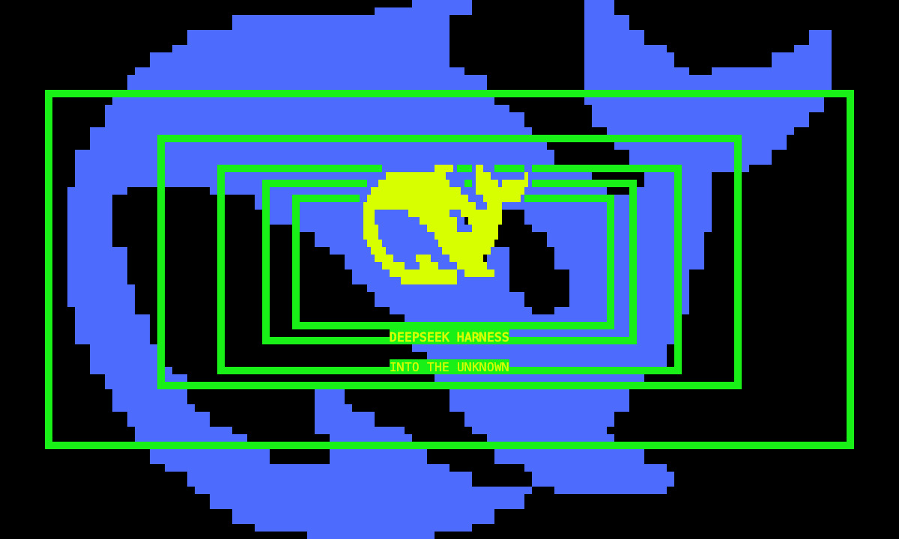

# dsh-tui-marathon

[简体中文](README.zh-CN.md)

A Marathon-inspired appearance plugin for DeepSeek Harness TUI. Version 0.4.1 provides an Acid Rain theme and a responsive full-screen opening through the stock TUI's public interfaces. Conversations, models, tools and storage remain with Harness / dsh-TUI.



The repository is named `dsh-tui-marathon`; the installable Cordis package is `dsh-theme-mls-tui`.

## Appearance and compatibility

- Automatic animation runs only at startup. Successful turns, cancellations and history replay never open an animation.
- Acid Rain yellow `#D7FF00`, dark surfaces and neutral body text. The opening retains electric blue, maze graphics and the red panel exit.
- Actual terminal text, block glyphs, borders and solid color cells replace the old full-frame sampled renderer.
- Green opening scan frames use solid half-row strokes, with vertical thickness matched to cell proportions for visibility across fonts.
- Both whale axes share one physical scale. Borders, maze and panels fill the viewport independently, including host page margins.
- The host frame clock drives motion without the former 50ms quantization. Measured moving-frame output is approximately 58 fps; terminal and machine load affect results.
- Resizing works during playback and pause. Validation covers 48–180 columns, 20–54 rows and several physical cell proportions.

The stock pixel whale has hardcoded blue pixels. The plugin hides it through public `setWhale(false)`, keeps the themed native title and restores the previous preference on unload. Set `nativeWhale: true` to retain that sprite.

Stock `tuiScenes` replaces the conversation. Panel masks animate within the plugin scene; the original conversation returns on close. Progressive reveal of native content needs an additional host interface. See [COMPATIBILITY.md](COMPATIBILITY.md).

## Install

Use Node `^22.19 || >=24`, the Harness CLI, and a Harness profile that already includes `@deepseek-harness-tui/dsh-tui` 0.14.x. Download [the v0.4.1 plugin archive](https://github.com/Huangmr0719/dsh-tui-marathon/releases/download/v0.4.1/dsh-theme-mls-tui-0.4.1.tgz), then run from the download directory:

```sh
dsh plugin --profile dsh-tui add ./dsh-theme-mls-tui-0.4.1.tgz
dsh --profile dsh-tui
```

Replace `dsh-tui` with your profile name. No host patch or recompilation is required.

For an existing source checkout that has completed the development setup below:

```sh
npm start
```

The official Harness CLI uses isolated development configuration and sessions in ignored `.runtime/`. Restart after source changes.

## Controls and configuration

`Alt+M` replays the opening. During animation, `Esc`, `Enter`, `q` or click exits; space pauses/resumes. Configure Option as Alt/Meta on macOS when needed.

| Cordis option | Default | Purpose |
| --- | --- | --- |
| `autoTheme` | `true` | Select and save MLS once on activation |
| `autoBoot` | `true` | Play the startup opening |
| `motion` | `full` | `reduced`: brief static display; `off`: theme only |
| `graphics` | `cells` | `auto`: use a supported host image only for the central logo; outer geometry stays native |
| `cellAspect` | `0` | Read host cell measurements; fall back to height / width = 2 |
| `nativeWhale` | `false` | Keep the unthemeable stock blue whale |

No terminal brand is required. If the host supplies no pixel metrics, arbitrary font proportions cannot be inferred exactly. Optional `cellAspect` calibration uses cell height / width, such as `1.8` or `2.2`. Native cell rendering needs no image protocol.

```sh
MLS_GRAPHICS=auto npm start
MLS_CELL_ASPECT=2.2 npm start
MLS_NATIVE_WHALE=1 npm start
MLS_MOTION=reduced npm start
npm start -- --inline
```

## Development

Source development uses Node `^22.19 || >=24` and pnpm `11.21.0`. Keep a stock `dsh-TUI/` checkout next to this repository for dev links and integration tests. The revision below is the verified host baseline:

```sh
git clone https://github.com/ccch1mneyyy/dsh-TUI.git
git -C dsh-TUI checkout 1d832df3f97e828b1aaea8376657d6b6ecf30b86
pnpm --dir dsh-TUI install --frozen-lockfile
pnpm --dir dsh-TUI build
git clone https://github.com/Huangmr0719/dsh-tui-marathon.git
cd dsh-tui-marathon
pnpm install --frozen-lockfile
npm run build
npm test
npm run verify
```

For an interactive run, `npm run setup:local` installs the official Harness CLI into ignored `.runtime/`; then run `npm start`. Configure API credentials through your shell environment as required by Harness. Do not commit credentials or sessions. Model-free tests need no API key.

Optional development commands:

```sh
npm run measure:motion
npm run pack:local
```

MIT licensed; retain artwork attribution. See [QUALITY.md](QUALITY.md) for validation and [THIRD_PARTY.md](THIRD_PARTY.md) for asset provenance and regeneration.
