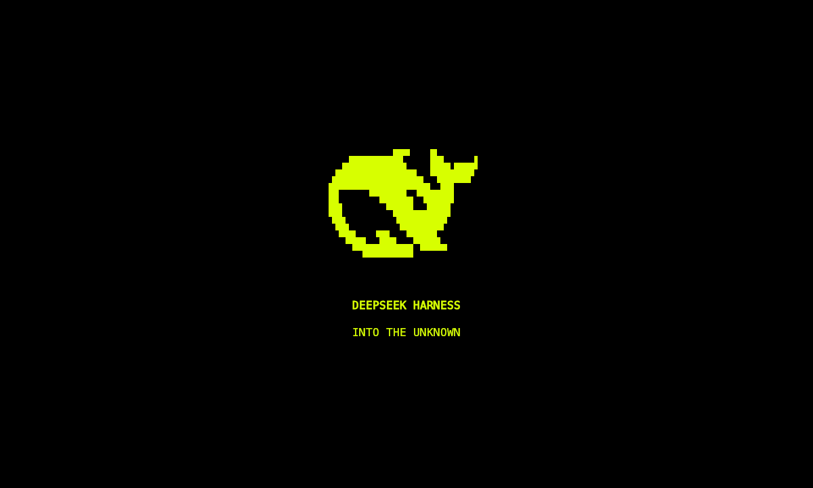

# dsh-tui-marathon

[English](README.md)

受《马拉松》视觉风格启发的 DeepSeek Harness TUI 外观插件。0.4.2 通过原版 TUI 的公开接口提供酸雨黄主题与全屏开场。宿主源码、对话、模型、工具和会话存储均由现有 Harness / dsh-TUI 管理。



来自实际 120×36 终端输出，以 24 帧/秒 GIF 回放；开场结束后返回原生界面。

GitHub 仓库名为 `dsh-tui-marathon`，可安装的 Cordis 包名仍为 `dsh-theme-mls-tui`。

## 安装后直接运行 dsh-tui

默认你已经安装 `dsh`、`dsh-tui` 和 pnpm，且原来的 `dsh-tui` 能正常启动。当前支持 dsh-TUI 0.14.x，已验证版本为 0.14.0。

只需安装一次主题：

```sh
dsh plugin --profile dsh-tui add https://github.com/Huangmr0719/dsh-tui-marathon/releases/download/v0.4.2/dsh-theme-mls-tui-0.4.2.tgz
```

以后仍然使用原来的命令：

```sh
dsh-tui
```

插件加入启动器默认使用的 `dsh-tui` profile，自动启用酸雨黄主题并播放开场。无需克隆源码、编译宿主或进入本项目目录。`DSH_HOME` 如有设置，安装与启动时使用相同的值。修改插件配置或更新后重启 `dsh-tui` 生效。

首次使用宿主时，开场结束后仍可按原有引导配置 API 凭据。主题不修改模型、凭据或会话配置。

也可以手动下载 [v0.4.2 安装包](https://github.com/Huangmr0719/dsh-tui-marathon/releases/download/v0.4.2/dsh-theme-mls-tui-0.4.2.tgz)，将上面命令中的 URL 换为下载文件路径。

卸载主题后，继续使用原来的 `dsh-tui`：

```sh
dsh plugin --profile dsh-tui remove dsh-theme-mls-tui
```

## 效果与适配

- 仅进入时自动播放开场；任务完成、取消和历史回放均不打开动画。
- 主色为酸雨黄 `#D7FF00`，搭配深黑底、灰白正文；开场保留电蓝、迷宫与红色分块退出。
- 默认使用实际终端文字、块字符、边框和实心色块，移除旧版整帧点阵渲染。
- 开场绿色扫描框使用加粗线形字符，保持清晰，同时收细线宽。
- 鲸鱼两个方向共用同一物理缩放比例；边框、迷宫和扫块分别按窗口宽高铺满，包括宿主页边距。
- 通过宿主时钟更新，取消旧版 50ms 帧量化。测试中的运动段输出约 58 帧/秒，实际表现取决于终端和负载。
- 窗口调整在播放、暂停时均生效。已覆盖 48–180 列、20–54 行以及不同字符格比例。

宿主原生像素鲸鱼使用写死的蓝色，公开主题接口不能重新着色。插件默认通过公开的 `setWhale(false)` 隐藏它，保留酸雨黄原生标题；卸载时恢复原值。设 `nativeWhale: true` 可保留原生鲸鱼。

原版 `tuiScenes` 替换对话视图。红扫在插件场景内分块退出，结束后返回原生界面；逐块揭露原生对话仍受接口限制。详见 [COMPATIBILITY.md](COMPATIBILITY.md)。

## 控制与配置

`Alt+M` 重播开场。动画中 `Esc` / `Enter` / `q` / 点击退出；空格暂停或继续。macOS 可将 Option 配成终端的 Alt/Meta。

| Cordis 配置 | 默认 | 用途 |
| --- | --- | --- |
| `autoTheme` | `true` | 激活时选中并保存 MLS 主题 |
| `autoBoot` | `true` | 启动时播放开场 |
| `motion` | `full` | `reduced` 静态短展示；`off` 仅应用主题 |
| `graphics` | `cells` | `auto` 在支持时只用宿主图片绘制中心鲸鱼；外围始终是字符 |
| `cellAspect` | `0` | 自动读取宿主字符格尺寸；缺失时使用高宽比 2 |
| `nativeWhale` | `false` | 是否保留无法换色的原生蓝色鲸鱼 |

不依赖某个终端品牌。宿主未提供字符格像素尺寸时，无法精确推断所有字体的高宽比；可将 `cellAspect` 校准为字符格高度 / 宽度，例如 `1.8`、`2.2`。默认字符渲染不要求图片协议。

## 开发

以下仅供修改源码使用；安装主题无需这些步骤。源码开发使用 Node `^22.19 || >=24` 与 pnpm `11.21.0`。通过 dev links 使用相邻的原版 `dsh-TUI/`，集成测试也使用该目录。以下固定宿主版本已通过验证：

```sh
git clone https://github.com/ccch1mneyyy/dsh-TUI.git
git -C dsh-TUI checkout 1d832df3f97e828b1aaea8376657d6b6ecf30b86
pnpm --dir dsh-TUI install --frozen-lockfile
pnpm --dir dsh-TUI build
git clone https://github.com/Huangmr0719/dsh-tui-marathon.git
cd dsh-tui-marathon
pnpm install --frozen-lockfile
npm run build
npm test
npm run verify
```

交互开发前执行 `npm run setup:local`，将官方 Harness CLI 安装到忽略的 `.runtime/`；随后运行 `npm start`。此入口使用隔离的开发 profile 与会话；正式使用走上方的 `dsh-tui`。按 Harness 要求通过 shell 环境提供 API 凭据，勿提交密钥或会话。模型无关测试无需 API key。

开发入口专用环境变量：

```sh
MLS_GRAPHICS=auto npm start
MLS_CELL_ASPECT=2.2 npm start
MLS_NATIVE_WHALE=1 npm start
MLS_MOTION=reduced npm start
npm start -- --inline
```

可选开发命令：

```sh
npm run measure:motion
npm run pack:local
```

遵循 MIT 许可证，保留第三方素材署名。测试边界见 [QUALITY.md](QUALITY.md)，素材来源与生成方式见 [THIRD_PARTY.md](THIRD_PARTY.md)。
